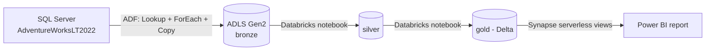

# Azure End-to-End Data Pipeline: SQL Server to Power BI

An end-to-end data engineering project on Azure. It moves sales data from a SQL Server database into a data lake, cleans it in layers (bronze, silver, gold), and shows it in a Power BI report.

**Dataset:** Microsoft's public sample database `AdventureWorksLT2022` (schema `SalesLT`, 10 tables). No real customer data is used.

**Based on:** the tutorial "Azure End-To-End Data Engineering Project for Beginners" by Luke Byrne. I followed the tutorial's overall design, then debugged and changed parts myself. See "What I changed or debugged beyond the tutorial" below.

> **Status:** The Azure free trial that hosted this project has expired. The Databricks notebooks and the ADF dataset and linked service definitions were lost with it. What survives is in this repo: the ADF pipeline JSON, the SQL scripts, the Power BI file and screenshots. The logic of the lost parts is described in plain words below.

## Architecture



| Layer | Tool | What it holds |
|---|---|---|
| Source | SQL Server, database `AdventureWorksLT2022` | 10 tables in schema `SalesLT` |
| Ingestion | Azure Data Factory | Pipeline `Copy_All_Tables` |
| Storage | Azure Data Lake Storage Gen2, account `intechsg26` | Containers `bronze`, `silver`, `gold` |
| Transformation | Azure Databricks | Notebooks `Bronze to Silver - Extended` and `Silver to Gold - Extended` |
| Serving | Azure Synapse serverless SQL | Views over the gold Delta tables, created with a stored procedure |
| Reporting | Power BI | One report page |

The 10 tables: `Address`, `Customer`, `CustomerAddress`, `Product`, `ProductCategory`, `ProductDescription`, `ProductModel`, `ProductModelProductDescription`, `SalesOrderDetail`, `SalesOrderHeader`.

## How it works

### 1. Ingestion to bronze (Azure Data Factory)

Pipeline `Copy_All_Tables` (`adf/Copy_All_Tables.json`):

1. **Lookup1** runs a query on `sys.tables` joined to `sys.schemas`. It returns the schema name and table name of every table in `SalesLT`.
2. **ForEach1** loops over that list. For each table, **Copy data1** runs `SELECT * FROM [schema].[table]` and writes the result as a Parquet file to the `bronze` container, in a folder per table.
3. The sink dataset `ParquetSink` takes two parameters, `Schemaname` and `Tablename`, so one dataset serves all 10 tables.
4. The source connection uses a SQL login with `SELECT` permission on the `SalesLT` schema only (`sql/Azure_SQL_Credential_Creation.sql`).
5. After the copy, two Databricks notebook activities run in order: `Bronze to Silver`, then `Silver to Gold`.

Proof: `screenshots/bronze.png` shows `bronze/SalesLT/` with all 10 table folders. `screenshots/adf-pipeline.png` shows the pipeline.

### 2. Bronze to silver (Databricks)

The notebook `Bronze to Silver - Extended` runs as an ADF activity after the copy finishes. It reads from `abfss://bronze@intechsg26.dfs.core.windows.net/` and writes to the `silver` container, one folder per table.

It converts date columns to the date type.

Proof: `screenshots/silver.png` shows `silver/SalesLT/` with all 10 table folders. `screenshots/databricks-storage-paths.png` shows the storage paths defined in the notebook.

### 3. Silver to gold (Databricks)

The notebook `Silver to Gold - Extended` runs after bronze to silver. It reads from `silver` and writes to `gold` in **Delta** format, one folder per table. Its first section is titled "Single Table Column Transformations".

The gold tables have snake_case column names. For example, `AddressID` in the source database became `address_id`.

Proof: `screenshots/gold.png` shows `gold/SalesLT/` with all 10 table folders. `screenshots/databricks-silver-to-gold.png` shows the notebook listing the silver folders.

### 4. Serving (Synapse serverless SQL)

The stored procedure in `synapse/sp_CreateSQLServerlessView_gold.sql` takes a table name and creates a view in the database `gold_db`. The view reads the Delta files from `https://intechsg26.dfs.core.windows.net/gold/SalesLT/<table>/` with `OPENROWSET`.

### 5. Reporting (Power BI)

`powerbi/AZURE_PROJECT.pbix` imports the gold views. The model has 11 tables: the 10 above plus `SalesLT_AddressView`. The report page shows:

- Cards: number of products (295), total sales (708.69K) and total orders (32)
- Donut chart: customers by title (Mr. 490, Ms. 340, other titles 17)
- Bar chart: sales by product category (Touring Bikes is highest at 221K)
- Table: top 10 products by sales
- Dropdown filters: customer title and product category

Row count example from Table view: `Address` has 450 rows.

Proof: `powerbi/dashboard.png`, `powerbi/model.png` and `powerbi/table-view.png`.

## Problems I hit and how I fixed them

| Problem | Cause | Fix |
|---|---|---|
| ADF Copy failed with `LeaseIdMissing` (`PreconditionFailed`) on `bronze` | In the sink dataset properties I had typed `item().SchemaName` and `item().TableName` as plain text. ADF did not evaluate them, so every table wrote to the same literal file path and parallel runs fought over the lease. | Entered both as dynamic content: `@item().SchemaName` and `@item().TableName`. Deleted the junk folder from `bronze` and re-ran. |
| Power BI charts showed meaningless numbers | I first built a bar chart that summed ID columns (`sales_order_detail_id` by `product_category_id`). | Rebuilt it with `ProductCategory` name and the sum of `line_total`. The category totals now add up to the 708.69K total sales. |

## What I changed or debugged beyond the tutorial

- The notebooks read storage with `abfss://` paths directly, instead of mounting the storage as the video does.
- Fixed a plain-text `item()` mistake that made all tables write to one file (see the bug table).
- Built and corrected the Power BI report myself: category sales, top 10 products, order count, and dropdown filters.

## What I would improve next

- **Incremental load.** The pipeline copies every table in full each run. A watermark column would copy only new or changed rows.
- **Parameters.** The schema name `SalesLT` is hardcoded in the Lookup query. A pipeline parameter would let one pipeline handle other schemas.
- **Retries and alerts.** Every activity has `retry` set to 0 and there is no failure alert. Add retries and an email alert on failure.
- **Data quality checks.** Compare row counts between bronze, silver and gold for each table and fail the pipeline if they differ.
- **Cleaner model.** Drop sensitive-looking columns such as `password_hash` before the report, remove the duplicate `SalesLT_AddressView`, and review relationship filter directions.
- **Time trends.** The sample orders fall in a single year (2008), so a sales-over-time chart was not useful. A larger dataset would allow one.

## Repo contents

```
├── README.md
├── adf/Copy_All_Tables.json                 # personal email in notebook paths replaced with a placeholder
├── sql/Azure_SQL_Credential_Creation.sql    # read-only login setup, placeholders only
├── synapse/sp_CreateSQLServerlessView_gold.sql
├── powerbi/AZURE_PROJECT.pbix, dashboard.png, model.png, table-view.png
└── screenshots/                             # bronze, silver, gold, containers, databricks x2, adf-pipeline
```

Not included: Databricks notebooks, ADF datasets and linked services (lost when the trial expired), and any credentials.
